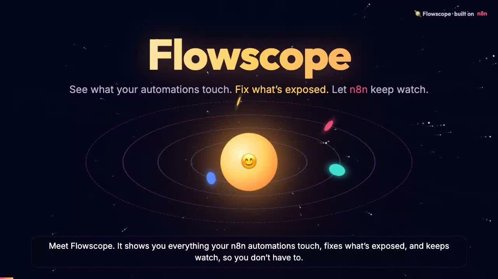
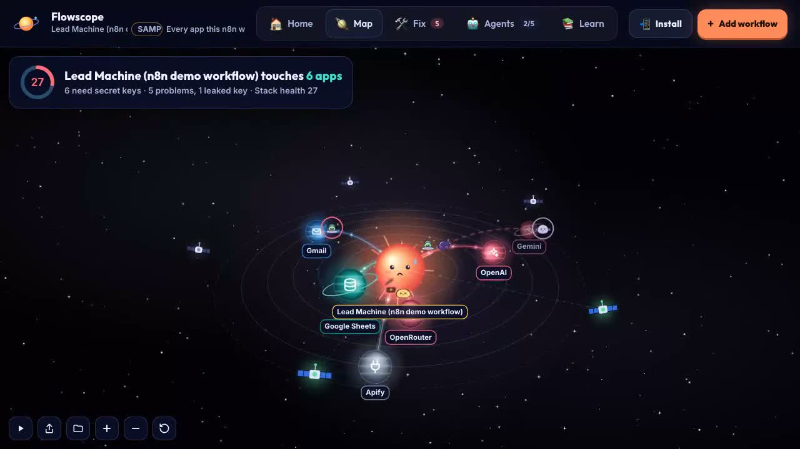
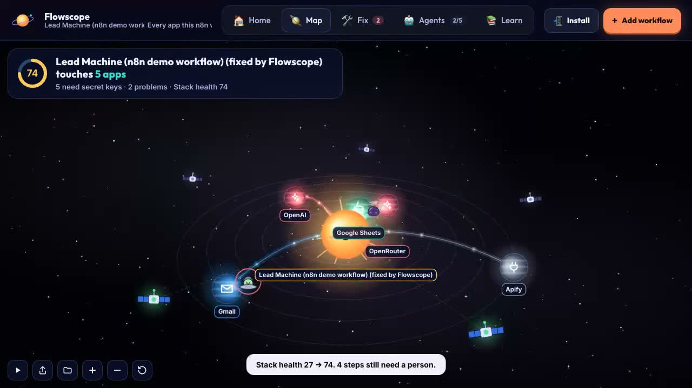
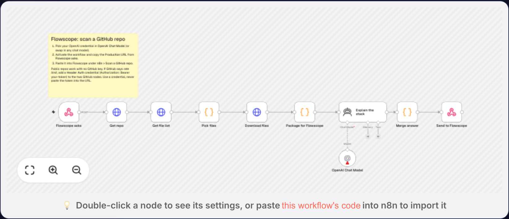
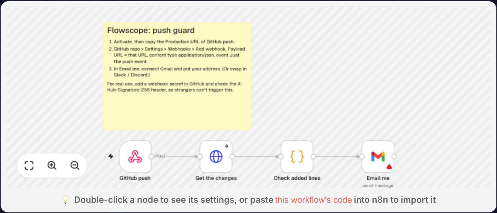

# 🪐 Flowscope

**See every app your n8n automations touch as a 3D solar system, fix what's exposed in one click (with proof), and let 5 n8n agents keep watch.**

By **Arushi Nirmal** · n8n Santa Clara University Buildathon · Nov 15, 2026

| | |
|---|---|
| 🚀 **Live app (installable PWA)** | https://arushish5-cyber.github.io/flowscope/ |
| 💻 **Full source** | https://github.com/arushiSH5-cyber/flowscope |
| 🎬 **2-minute film** | https://github.com/arushiSH5-cyber/flowscope/blob/main/media/flowscope-film.mp4 |
| ⚙️ **The 5 n8n workflows** | [`workflows/`](workflows) (import any of them into n8n) |

## The problem
One person can wire a dozen apps together in an afternoon. Keys get pasted into nodes, webhooks get left open, and when a workflow breaks at 3 a.m., nobody hears about it.

## What Flowscope does
- **See:** your workflow is the sun, every app it uses is a planet, every problem is a space hazard (comet = leaked key, UFO = open webhook, black hole = silent failure).
- **Fix:** the 🪄 Fixer hands back a repaired n8n workflow to paste straight back in. On the n8n demo workflow, health goes **27 → 74**.
- **Prove it:** the same checks run again on the fixed JSON: API keys in nodes **1 → 0**, open webhooks **1 → 0**, turned-off nodes **1 → 0**.
- **Keep watch:** 5 n8n agents.

| 😟 Before (27) | 😄 After (74) |
|---|---|
|  |  |

## How n8n is the heart
The app is one web page (the 🧠 brain: rules that read, score and fix a workflow in the browser). **Everything that touches the outside world runs in n8n.** No server of our own.

| Agent | n8n nodes | Status |
|---|---|---|
| 🔭 **Scout** (repo scanner) | Webhook → HTTP Request (GitHub) → Code → **AI Agent** → Respond to Webhook | ✅ Live, tested (6–10 s) |
| 🛡️ **Guard** (push guard) | GitHub Webhook → HTTP Request → Code → Gmail | ✅ Live, caught a fake AWS key in 2.2 s |
| 🤖 **Buddy** (MCP server) | MCP Server Trigger → HTTP Request Tool + Code Tools | Built, needs a token |
| 🚨 **Siren** (error alerts) | Error Trigger → Gmail | Built, needs Gmail |
| 🕵️ **Inspector** (weekly audit) | Schedule → n8n API → Code → Gmail | Built, needs Gmail |

## Why not just ask an AI?
A chat only helps when you remember to ask. **Claude is who you ask. Flowscope is who's watching.** And they work together: Buddy lets Claude or Cursor call Flowscope through n8n.

## For vibe coders and students too
Add your GitHub repos and see which projects are 🟢 alive, 🟡 getting quiet or 🔴 forgotten (keys and all), then scan any of them with n8n.

 📱 Scan to open the app on your phone.
