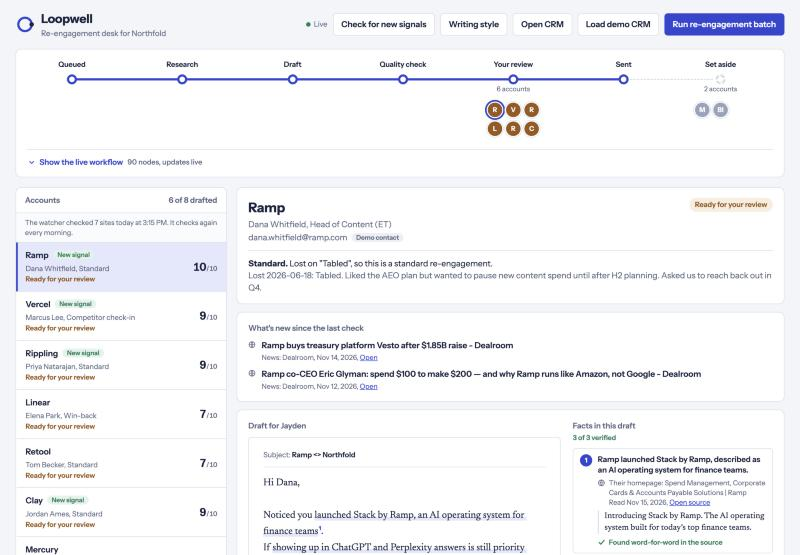
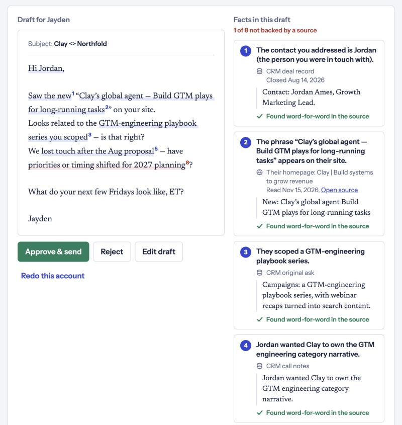
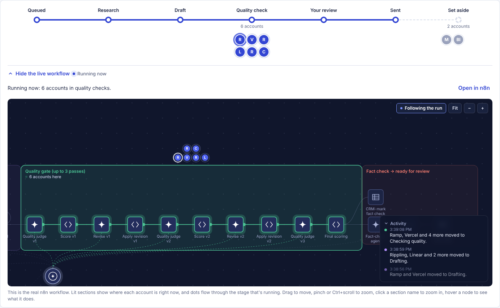

# Loopwell: re-engagement desk (n8n)

Built for the n8n Buildathon at Santa Clara University (Nov 2026).

One n8n workflow, 97 nodes, seven sections. No Slack: everything happens on one screen.
1. **Review desk + API**: n8n serves the dashboard at `/webhook/loopwell`. The page uses `/webhook/loopwell-api` to list, run, edit, reset, approve and reject. Anyone with the link can look; every change needs the passcode.
   - **Live workflow:** under the pipeline row, **Show the live workflow** opens the real n8n graph, drawn from the workflow itself at build time. Sections light up as accounts move through research, drafting, quality checks and fact check, dots flow through the stage that's running, account chips sit where each account is, and an activity feed lists every move. **Following the run** glides the camera to the active stage. It reads the same status the desk already polls, so it costs no extra executions.
2. **Research agent**: reads each company's homepage and the last 120 days of Google News. The agent picks one opener signal. Code then checks the quote word-for-word against the source and throws out anything adverse or unverifiable.
3. **Drafting agent**: follows the rules of the recovered re-engagement skill. It picks an angle by track, handles the loss reason correctly, writes 3 to 5 short lines and closes with a Friday ask in the recipient's timezone.
   - **Your writing style:** click **Writing style** on the desk and import a Markdown file from Claude, like a skill or a voice guide. The writer, the rewriter and the judge all follow it for voice, tone and word choice. The fixed rules still apply: facts from sources only, the loss-reason rules, length, subject line, Friday ask and sign-off. The guide is saved in `loopwell_settings` (key `style`), capped at 15,000 characters, and applies from the next run.
   - **It learns from your edits:** when you save an edited draft, a Style Learner compares your version with the AI's and turns what you changed into short rules ("Open with what you noticed, in plain words."). The desk tells you what it learned, the rules show up under **Writing style → Learned from your edits** (each with **Forget**), and every new draft, rewrite and judge pass follows them. Fact corrections and typo fixes aren't treated as style. Up to 10 rules, stored in `loopwell_settings` (key `learned`).
4. **Quality gate**: each pass runs 15 rule checks in code plus an LLM judge. Failing drafts get rewritten with the exact list of failures, up to 3 passes.
5. **Fact check**: a fact-check agent lists every factual claim in the final draft and the CRM field or web quote it rests on. Code marks a claim verified only when it finds the claim in the draft *and* the evidence word-for-word in the cited source, so the model can't vouch for itself. The desk numbers each claim in the email and lists it on the right with its source, date, link and supporting quote. Claims with no source show red and are called out before sending.
6. **Approve on the desk → send from Gmail**: **Approve & send** re-reads the latest saved version, so edits count, and sends it from Gmail. Each account is emailed at most once: repeat approvals, batch reruns and Redo all skip sent accounts. **Reject** sends nothing. If Gmail fails, nothing goes out and the draft stays ready to retry.
7. **Signal watcher** (how it knows who to pick): every morning at 8:03, and whenever you click **Check for new signals**, it re-reads the homepage and recent news of every open account. New homepage headlines since the last snapshot, or fresh news that an AI relevance check confirms is really about the company (name collisions like "Retool the defense" and adverse stories are dropped), mark the account **New signal** with a "What's new" panel and send it straight through research and drafting. The same triage rules still apply, so cooldowns hold, and drafts you edited are flagged instead of overwritten. The first check takes a homepage baseline and counts the past week's news as new. Snapshots live in the `loopwell_watch` Data Table.

## Setup on n8n Cloud (about 10 minutes)
1. **Import:** Workflows → Import from file → `loopwell-n8n-workflow.json`.
2. **OpenAI:** open the **OpenAI Chat Model** node and create a credential. Use n8n's free AI credits if the credential offers them; otherwise use the hackathon's key. Pick **Use Gateway credits** if offered. The model is set to `gpt-5-mini`; with Gateway credits, `gpt-4.1-mini` is rejected.
3. **Gmail:** open **Gmail: send email** and sign in with Google.
4. **Passcode:** in n8n, go to **Data tables**, create a table named `loopwell_settings` with two text columns, `key` and `value`, and add one row: key `approve_passcode`, value your passcode. The passcode lives only in your n8n, never in this repo. Optional: add a second row, key `crm_url`, value the address of your `loopwell_accounts` table (open it in n8n and copy the URL), so the dashboard's **Open CRM** button lands right on it. Without it, the button opens n8n's Data tables list.
5. **Publish** the workflow (top right). Production webhooks only work while it's published.
6. **Open the dashboard:** go to `https://YOUR-SUBDOMAIN.app.n8n.cloud/webhook/loopwell`, click **Load demo CRM** (this creates the `loopwell_accounts` data table with 8 accounts), then click **Run re-engagement batch**. The first change you make asks for the passcode; the page remembers it until you reload.
7. **Demo inbox:** add one more `loopwell_settings` row: key `demo_inbox`, value your own email. The demo CRM shows realistic customer addresses (dana.whitfield@ramp.com and so on), but those people are made up, so **Approve & send** delivers demo drafts to your inbox instead, plus-tagged per account (you+ramp@…). The desk marks them **Demo contact** and the send dialog names the real destination. Without the row, demo drafts can't be sent at all. Accounts you add to the CRM yourself send to their own contact email.
8. Open a draft and click **Approve & send**. It lands in your inbox seconds later.

## Demo data
8 synthetic CRM records on real companies, so the research step pulls live signals. The contacts and their addresses are made up and are never emailed (see setup step 7). Each record tests a rule:
- **Ramp:** tabled, so the draft names the timing.
- **Rippling:** lost on budget, so the draft must never mention money.
- **Retool:** lost to an internal hire, so the draft asks whether the hire worked out.
- **Clay:** went quiet after the proposal (no response).
- **Vercel:** tagged Competitor + Price. Competitor wins, so it gets a no-pitch check-in.
- **Linear:** former customer, so it goes on the win-back track.
- **Mercury:** lost to a competitor 3 weeks ago, so it's held back by the 90-day cooldown.
- **Course signup:** junk record, so it's cleaned up with no draft.

To change accounts, edit the **Seed demo accounts** node, then click Load demo CRM again.

## If something breaks
- **"webhook not registered":** the workflow isn't published.
- **Cards stuck on Researching or Drafting:** open Executions and look at the red node. It's usually the OpenAI credential or model.
- **The dashboard says Offline:** the URL must be `/webhook/loopwell` (not `/webhook-test/`), and the workflow must be published.
- **To reset the demo:** click Load demo CRM. It clears every draft and status, including Sent, so accounts can be emailed again.
- **"No demo inbox is set":** add the `demo_inbox` row from setup step 7.
- **"No passcode is set yet":** add the `loopwell_settings` row from setup step 4. **"Wrong passcode":** check the value in that row.
- **Execution count:** the dashboard polls every 2.5 seconds during a run and every 20 seconds when idle. Close the tab when you aren't demoing.

## What was tested
I ran the workflow end to end on n8n 2.47.7 locally with a mock LLM and a stubbed Gmail. Everything below passed:
- Table creation and seeding
- Triage and cooldowns
- Homepage and RSS parsing
- Quote verification: a made-up quote was rejected
- Sensitivity screen: news with layoffs was dropped
- Rewrite loop: draft 1 scored 0/10 and failed 7 checks; draft 2 scored 9/10 and passed every check
- Dashboard edits with live checks
- Passcode: viewing is open; run, edit, reset, approve and reject are refused without the right passcode
- Approve & send (once per account): repeat approvals, rejecting a sent account, batch reruns and Redo all leave sent accounts alone
- Reject, then change your mind and approve
- Gmail failure: nothing is sent and the draft stays ready to retry
- Signal watcher: first check sets baselines and catches the past week's news; a changed homepage headline is caught and only that account is drafted; a repeat check reports nothing new; numbers changing on a page don't count; needs the passcode
- Live workflow (`test/ui_flow.py`, mock LLM slowed to 4 s per call): with the map open, a batch was caught in research, drafting, quality checks and fact check in turn; the camera followed each stage, the feed logged every move, zoom, pan, section zoom and node tooltips worked, no page errors
- Learning from edits: rewriting an opener produced a rule; the rule reached the next draft; saving the same edit again added nothing; Forget removed it; works end to end in the browser
- Writing style: saving needs the passcode; the guide reaches every draft, rewrite and judge call; reset goes back to the default; oversized files are trimmed with a note
- Fact check: claims backed by the CRM or the web quote are verified; invented evidence, the wrong source and unsourced claims are not; edited lines show as not re-checked
- The dashboard flow in a real browser (`test/ui_approve.py`): wrong passcode, right passcode, sent, passcode remembered

On n8n Cloud, real OpenAI research and drafting ran end to end, and the passcode and skip paths were checked live. On a live Ramp run the fact checker verified 5 claims and caught one the quality judge had passed at 10/10: the draft said Ramp promotes "agent-based workflows", but the homepage only says "AI operating system". The first real Gmail send happens when you click Approve & send.

## Working on it
```
src/
  dashboard.html     review desk UI (served by n8n)
  prompts/*.md       research, drafting, judge and revision prompts
  code/lib.js        shared rule checks, used by both the workflow and the dashboard editor
  seed.json          the 8 demo CRM accounts
build.py             builds dist/*.json from src/
dist/
  loopwell-n8n-workflow.json   import this into n8n Cloud
  loopwell-local-test.json     same workflow with Gmail stubbed, a mock LLM and passcode test-pass, for local testing
test/
  mock_server.py     mock OpenAI + mock homepages + mock Google News RSS
  ui_approve.py      browser test of Approve & send (needs a finished local batch)
  mock-credential.json, shoot.py, canvas.py   local test helpers
```

Edit files in `src/`, then run `python3 build.py` to regenerate `dist/`.

**n8n holds the live version.** If you change nodes in n8n's editor, export the workflow (... menu → Download) and commit it to `dist/`, or port the change back into `src/` and rebuild. Agree on who owns which part so you don't both edit the workflow at once.

**Unit tests for the shared helpers** (JSON repair, rule checks), using real model outputs from `test/fixtures/`:
```
node test/test_lib.js
```

**Local test without spending AI credits** (n8n 2.47 needs Node 24):
```
python3 test/mock_server.py 8765 &
npx n8n import:credentials --input=test/mock-credential.json
npx n8n import:workflow --input=dist/loopwell-local-test.json
npx n8n publish:workflow --id=loopwellTest0001
N8N_LISTEN_ADDRESS=127.0.0.1 npx n8n start
# then open http://127.0.0.1:5678/webhook/loopwell
```

Never commit API keys. n8n exports only reference credentials by ID, so exported workflows are safe to commit.



Every claim in a draft is numbered and traced to its source. Here the fact checker verified the homepage quote and the CRM notes, and flagged one line it couldn't back (the red tally and the red-underlined phrase):



The live workflow map, opened under the pipeline row while a batch runs. This is the real n8n graph; the lit section is where the batch is right now:



## 2-minute demo script
- **0:00, the problem.** Agencies sit on hundreds of dead deals. Reviving one well takes real research and careful writing, and generic follow-ups get ignored. I built this workflow by hand during my Animalz internship as a Claude skill, tuned on the edits the CEO made to every draft. Loopwell turns it into an agent system in n8n.
- **0:20, who to pick.** Click **Check for new signals**. The watcher re-reads every open account's homepage and news, drops headlines that only share the name, and drafts the accounts where something real happened (Ramp's Vesto acquisition, Vercel's UI SDK). That runs every morning on its own.
- **0:30, click Run** for the full batch. Watch the loop line. Triage happens in code: Mercury is held back by the 90-day competitor cooldown, the course signup gets cleaned up, and Vercel is tagged Competitor *and* Price. Competitor wins, so it gets a no-pitch check-in.
- **0:40, under the hood.** Open **Show the live workflow** while it runs. That's the actual n8n graph: the lit section is where the batch is right now, and the camera follows it from research to fact check.
- **0:45, research.** It reads each homepage and Google News live and picks one opener. Open a card and point at the green check: the quote was verified word-for-word in the source, so the agent can't invent a fact. Adverse news like layoffs is screened out.
- **1:00, quality gate.** Show Draft 1 failing (dash greeting, a banned phrase, a number it made up), then Draft 2 passing at 9/10. That's 15 code checks plus an LLM judge, up to 3 passes.
- **1:15, proof.** Point at the numbered facts next to the draft. Every claim links to the CRM note or the web quote behind it, and code checked each quote word-for-word. If a claim has no source it turns red, even when the judge loved the draft.
- **1:30, human in the loop.** Edit a draft and watch the rule checks update as you type. Save it, and Loopwell tells you what it learned from your edit; the next draft already writes that way. Click **Approve & send**, enter the passcode, and the email lands in your inbox seconds later. Click it on a sent account and it's refused, so nothing double-sends. Everything happens on one screen.
- **1:45, the close.** Loopwell is an n8n system agencies can run on their own CRM. The rules come from emails a founder actually sent.
