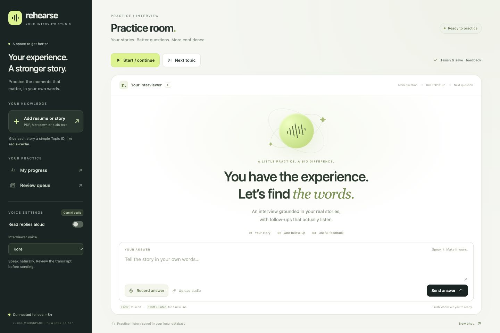
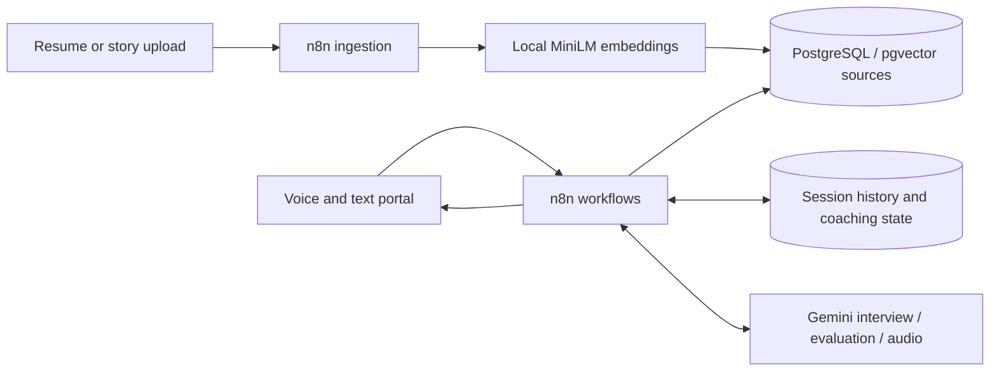

# Rehearse — a personal interview studio built with n8n

Practice out loud with questions grounded in your own experience. Rehearse asks **one answer-specific follow-up per main question**, then moves on. Finish whenever you are ready to receive an evidence-grounded debrief and a plan for your next practice session.

**SCU n8n Buildathon · November 15, 2026 · William-Ta0**



## Why this exists

Generic interview bots ask disconnected questions and forget what needs practice. Rehearse connects the candidate's own project material, interview conversation, and saved coaching state. It is designed for technical and behavioral interviews, with voice input and spoken questions.

## What to demo

1. Upload a resume experience or behavioral story as PDF, DOCX, Markdown, or plain text.
2. Click **Start / continue**. The interviewer retrieves relevant passages from that material.
3. Click **Record answer**, speak, stop, review the editable transcript, and click **Send answer**. You can also type.
4. The interviewer asks one follow-up grounded in the answer, with an exact supporting quote. Answer it to advance to the next main question.
5. Click **Finish & save feedback** for strengths, gaps, scores, next actions, and review dates. **My progress** and **Review queue** carry the coaching state into future sessions.

Turn on **Read replies aloud** in the sidebar for spoken interviewer replies. On narrow screens, expand **Settings** first. The browser may require a click on the audio player's Play button.

The `examples/` directory contains fictional templates, not real candidate records. Use Topic IDs such as `cache-project` or `team-conflict`; IDs accept letters, numbers, underscores, and hyphens.

## Run locally

Requirements: Docker Desktop with Docker Compose v2, Python 3.10+, and internet access for container/model downloads and Gemini calls. No host Node.js or paid embedding API is required.

```sh
git clone --branch rehearse-interview-agent --single-branch https://github.com/William-Ta0/n8n-scu.git
cd n8n-scu/rehearse
python3 scripts/setup.py --publish
```

The setup generates local secrets, builds/starts four services, initializes PostgreSQL, and imports/publishes the five n8n workflows. The embedding model downloads on first start, which can take several minutes.

After startup:

1. Open **http://localhost:5678/home/credentials**. Complete n8n's local owner setup if prompted.
2. Open **Interview Gemini - add API key**, enter your own Gemini API key, and save. Keep Host as `https://generativelanguage.googleapis.com`. Use a Google project with working API quota/billing.
3. Open **http://localhost:5678/form/interview-materials** to add a story. Confirm the indexed-passage count.
4. Open **http://localhost:5677** to practice.

The n8n Assistant's **Connect a model** dialog is separate from the saved credential used by these interview workflows.

| Service | Address |
| --- | --- |
| Voice/text practice portal | http://localhost:5677 |
| n8n workflow editor | http://localhost:5678/home/workflows |
| Material upload | http://localhost:5678/form/interview-materials |
| PostgreSQL/pgvector | Internal Docker network only |
| Local embedding service | Internal Docker network only |

This submission runs locally; there is no public hosted demo endpoint. Each reviewer runs their own instance with their own API key. A localhost URL points to the computer opening it.

## n8n is the orchestrator

The Node.js portal handles recording, transcript review, and playback. Interview orchestration, retrieval, memory, grading, and progress persistence run through n8n.

| Workflow | Responsibility |
| --- | --- |
| `interviewIngest` — Interview 01 | Extract and chunk uploads, create local embeddings, publish a pgvector source revision, and report indexing results. |
| `interviewChat` — Interview 02 | Retrieve source passages, generate questions/follow-ups, track session state, validate evaluation evidence, and save feedback. |
| `interviewReview` — Interview 03 | Refresh the daily review plan; the chat can also read the live review queue. |
| `interviewVoiceTranscribe` — Interview 04 | Send recorded audio to Gemini and return editable transcription text. |
| `interviewVoiceSpeak` — Interview 05 | Generate Gemini speech and return browser-playable audio. |

Exported workflow JSON is in [`workflows/`](workflows/); the generators in [`scripts/`](scripts/) are the reproducible source. Credentials are configured separately and are not exported with real keys.



### Memory and retrieval

- **Source memory:** Local `Xenova/paraphrase-multilingual-MiniLM-L12-v2` produces 384-dimensional passage vectors. pgvector stores and searches them. The same embedding profile embeds retrieval queries.
- **Conversation context:** Native n8n Postgres Chat Memory stores the Agent's recent context under the round UUID.
- **Authoritative session state:** PostgreSQL stores accepted questions/answers, main/follow-up progression, and the link between a follow-up and its parent answer. A session lease serializes turns.
- **Long-term coaching state:** Explicit Finish validates evidence and commits the debrief, topic scores, weaknesses, next action, and review dates together. These records inform later practice. Candidate answers are not automatically promoted into source facts.
- **Browser state:** The portal preserves its chat ID, draft, voice setting, and latest 100 visible messages in localStorage. New chat keeps database progress.

There is no question-count cutoff. The rhythm is main question → answer → one grounded follow-up → answer → next main question. With one uploaded story, later main questions cover another aspect of that story. Finish explicitly ends and grades the round.

### Grounded follow-ups

The model receives the exact current main question and answer. It returns a question and a verbatim supporting quote. Both workflow code and SQL validate that quote and parent question relationship. No artificial response delay is used. Evaluation has a separate structured schema and rejects invented topic IDs, out-of-range scores, and unsupported evidence; failed evaluation leaves mastery unchanged.

## Model configuration

[`model-config.json`](model-config.json) contains model names, never keys. The submitted profile uses Gemini for interviewing, evaluation, transcription, and TTS, with local embeddings. Model availability and quota depend on the reviewer's Google project. To select a chat model available to your account:

```sh
python3 scripts/setup.py --publish --provider gemini --model YOUR_AVAILABLE_MODEL_ID
```

An OpenAI chat/evaluation compatibility profile is also available through `--provider openai --model YOUR_AVAILABLE_MODEL_ID`; configure **Interview OpenAI - add API key** in n8n. Voice still uses Gemini. Changing only the chat model does not require reindexing source documents. Changing the embedding model does.

## Data and limitations

- Extraction, embedding, and vector indexing run locally in Docker. During interviews, relevant source passages, questions, and answers are sent to the chosen chat provider. Audio is sent to Google for transcription and speech generation.
- API keys stay in n8n's encrypted credential store. `.env`, credential import files, database backups, private uploads, real candidate transcripts, and recordings are excluded from this submission.
- Submitted answers and assessments persist in PostgreSQL. Raw audio is transient in the browser and is not retained in the two audio workflows' execution history. Other n8n execution payloads are retained for up to seven days for diagnosis.
- This is a local, single-candidate prototype. Topic progress is shared across sessions in that installation. It is not a multi-user service.
- Uploads accept UTF-8 text, PDF, DOCX, and Markdown up to 10 MB. Scanned PDFs require OCR first. Recordings stop after three minutes and transcripts remain editable before submission.
- Scores are practice feedback, not hiring predictions. API failures preserve the answer draft for retry.

## Validation and maintenance

See [VALIDATION.md](VALIDATION.md) for development evidence and the submission checks. Reproduce the isolated integration suites sequentially:

```sh
python3 tests/run_integration.py --provider gemini
python3 tests/run_integration.py --provider openai
```

These use a separate Docker project/database/volumes, real local embeddings, and deterministic model doubles. They test orchestration without paid model calls. They do not establish model quality or transcription accuracy for every speaker.

```sh
docker compose up -d                 # Start existing services
docker compose stop                  # Stop while preserving data
docker compose ps                    # Service status
docker compose logs --tail=80 n8n    # Diagnostics
sh scripts/backup.sh                 # Local backup; do not commit it
```

Keep the generated `.env` securely with backups: its encryption key is required to restore n8n credentials. `docker compose down` preserves volumes; adding `-v` deletes their data. Reimporting generated workflows can overwrite edits made in the n8n editor, so export customizations first.
